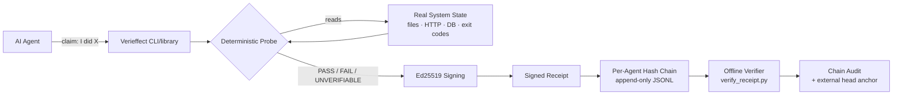

# Verieffect

[](https://pypi.org/project/verieffect/)
[](https://pypi.org/project/verieffect/)
[](https://github.com/bfeng1122/verieffect/blob/main/LICENSE)
[](https://github.com/bfeng1122/verieffect/actions/workflows/tests.yml)

**Verify the effect. Not the claim.**

*Independent, deterministic verification for AI agents — with signed, offline-verifiable
receipts as the evidence format.*

When an agent says "I uploaded the file" / "the trade filled" / "the backup ran" —
Verieffect probes ground truth *itself* and issues a receipt anyone can verify offline.

```console
$ # the backup agent's log says: "nightly backup ran ✓"
$ verieffect claim file_exists --agent backup-cron \
    --target ./backups/nightly.dump --expect '{"min_bytes": 1048576}' --out receipt.json
{
  "v": 1,
  "claim_id": "08798282-a3f5-4336-88a7-4077db23c923",
  "agent_id": "backup-cron",
  "kind": "file_exists",
  "target": "./backups/nightly.dump",
  "expect": { "min_bytes": 1048576 },
  "observed": { "path": "backups/nightly.dump", "exists": true, "is_dir": false,
                "is_regular_file": true, "size": 2, "mtime": 1794520971 },
  "verdict": "FAIL",
  "checked_at": "2026-11-12T22:02:51Z",
  "prev_receipt_hash": "0000...0000",
  "sig": "ed25519:dd90863d…"
}
$ echo $?
1
$ python -m verify_receipt --pubkey ~/.verieffect/keys/verieffect_ed25519.pub receipt.json
VALID: ok (claim 08798282-a3f5-4336-88a7-4077db23c923, verdict FAIL)
```

The file exists — it's just 2 bytes. "Backup ran" was true; "backup landed" wasn't.
The signed `FAIL` receipt is the evidence, and exit code `1` lets cron alert on it.

> **What the signature does and doesn't prove.** The signing key lives next to your
> agents (same host, MVP). Receipts are therefore **tamper-evident against drift and
> sloppy self-reports — not tamper-proof against an adversarial agent with local code
> execution** (such an agent could read the key and forge receipts). Verieffect is a
> *drift detector* for the well-documented "agent says done, side effect didn't
> happen" failure mode. Hosted/separate-user verification is on the roadmap. Details:
> [threat model](https://github.com/bfeng1122/verieffect/blob/main/docs/receipt-schema.md#threat-model-what-receipts-do-and-dont-prove).

- **No LLM in the verdict path.** Verdicts come from deterministic probes: filesystem
  state, HTTP responses, database rows, command exit codes. A model never *opines*
  that work succeeded; evidence shows it.
- **Signed receipts.** Ed25519 signature + per-agent hash chain, so receipts can't be
  altered without the key, and edits after the fact are detected. (Honest scope: the
  chain detects edits and mid-chain deletions; tail truncation needs an externally
  anchored head hash — see [Checkpointing](#checkpointing-anti-truncation) below.)
- **Three verdicts, never two.** `PASS` / `FAIL` / `UNVERIFIABLE`, each with its own
  exit code (`0` / `1` / `3`). A network error, timeout or missing binary is never
  laundered into a pass (or a fail). A missing file is never excused as "couldn't
  check." A typo'd or unknown `expect` key is never silently ignored: it is
  `UNVERIFIABLE` and the receipt names the key.

## Why

Two things are true at once: agent tasks get done wrong surprisingly often, and agents
tend to report them as done anyway.

**Tasks silently done wrong.** An analysis by [Veridatum](https://veridatum.io/) — a
similar project we compare against below — of the public τ-bench retail benchmark found
that **118 of 456 simulated GPT-4.1 runs (26%) failed the final-state check**: the
agent's transcript and the database disagreed. Veridatum is explicit that this is a
public-benchmark demonstration, not a real-world error rate, and it measures wrong
outcomes rather than false reports. Our own inference (not Veridatum's claim): nothing
in the agent's transcript tells you *which* runs were wrong — you find out only by
checking the system of record.

**Agents report failures as success.** The overclaiming evidence comes from the
research literature:

- **LIMBO** ("Where Does Exactly-Once Live?", arXiv:2609.29095): in one experimental
  setup (E1), of 1,279 episodes that produced a duplicate side effect, **the agent
  finished with status "completed" in 90% (95% CI 78–96%).** This is the closest
  published evidence to exactly what Verieffect catches — the self-report says
  "done," the system of record says otherwise.
- **OverclaimBench** (arXiv:2609.20812): **80.4% of incomplete runs** were reported in
  a misleading way — 52.8% explicit overclaims plus 27.5% that omitted the gap, so
  omissions are included in the figure. Coverage (which files entered the agent's
  context) is measured deterministically, but the admission/omission/overclaim
  classification of incomplete runs is made by an **LLM judge** (Claude Opus 4.8; the
  paper reports 91.1% unanimous verdicts across 8 re-judgments, disagreements
  concentrated on the overclaim/omission boundary — not on the misleading-vs-admission
  line that carries the headline).
- **["The Completion Illusion: Why AI Agents Overclaim Done, and the Case for an Agent
  Control Tower"](https://labs.iovstudio.kr/en/papers/agent-control-tower)** (Han Kim,
  IOV Labs; a lab study, not peer-reviewed): across 896 verifiable micro-task
  instances and 4 models, agents self-reported 100% completion while verified
  accuracy was 86–96%.

Autonomous agent stacks — cron-driven pipelines, CI bots, personal agents — fail the
same way: the log says "done," the side effect never happened (or happened twice).
Verieffect makes "done" a verifiable claim.

## Related work (read this before assuming we invented it)

Verifying an action's *effect* instead of trusting the actor's self-report is a
published principle, not our invention. We built a working implementation; others
described the idea or solved adjacent problems:

- **[Re-Perceived Effects: A Well-Formedness Contract for Accountable Actuation](https://doi.org/10.5281/zenodo.22768261)**
  (Zain Dana Harper, Sept 2026). The closest prior art: replace the actuator's
  self-report with a *re-perceived* effect read back from the world — re-hash the
  file, check the process return code — with a total checker that yields
  "Unverifiable" on malformed input rather than raising. Same core principle and
  several of the same rules as our `file_exists`/`exit_code` probes. It's a short
  conceptual note; Verieffect is a shipped, tested implementation (285 test checks, CI,
  dogfooded) and adds the packaging that note names as its own gap: sealed
  receipts re-verifiable offline.
- **[Beyond Approved Actions: Runtime Validation of Persistent Outcomes in Agent Workflows](https://arxiv.org/abs/2609.31301)**
  (EffectMatch, Sept 2026). Broader than us: binds an application-approved outcome
  to the execution and governs commit/continuation from the comparison. We verify
  individual claims after the fact; they enforce a contract across a workflow.
- **[Treeship](https://github.com/zerkerlabs/treeship)** (Apache-2.0),
  **[Attestroot](https://pypi.org/project/attestroot/)**,
  **[Logsiegel](https://logsiegel.com)**, **[Tanilo](https://tanilo.io)** — signed,
  hash-chained/Merkle agent receipts with offline verification. Overlapping on the
  *receipt* layer. The distinction: they **record what the agent did** (wrap commands,
  seal transcripts); Attestroot states plainly that a capture controlled by the party
  being audited "would seal and verify perfectly." Verieffect **queries the system of
  record itself** when
  the claim is filed. The probe runs inside Verieffect, not inside the agent. (Offline
  verification later checks the receipt's authenticity; it does not re-probe.)
- **[Veridatum](https://veridatum.io/)** — the same principle (check the claim against
  the system of record) as closed SaaS for business outcomes (Stripe refunds, orders).
  We're the open-source, developer-facing, technical-claim version.
- Standards: [in-toto](https://in-toto.io)/[SLSA](https://slsa.dev) attest *artifacts
  and builds*; [C2PA](https://c2pa.org) attests *content provenance*. None answers
  "did this runtime side effect land in my DB at 3am." Adopting their envelope formats
  (RFC 8785 canonical JSON, DSSE) is on our roadmap — we'd rather compose than compete.

**What's left that's ours:** a Python-native probe library you can extend, strict
three-verdict semantics, signed hash-chained receipts with agent-binding and
truncation detection, a dependency-light offline verifier, and exit codes built for
cron/CI. Implementation and developer experience — not the underlying idea.

## Quick start

Works verbatim from an **empty folder** (bash/zsh; Windows notes below):

```bash
# 0. Install — gives you the `verieffect` console script and the
#    `verify_receipt` offline-verifier module
pip install verieffect

# 1. Something for an agent to claim it produced
echo "hello" > proof.txt

# 2. File a claim — the probe checks the file itself; this PASSES (exit code 0).
#    The first claim auto-generates your signing key under ~/.verieffect.
verieffect claim file_exists --agent my-agent --target ./proof.txt --expect '{"min_bytes": 1}' --out receipt.json

# 3. Verify the receipt offline (needs only the public key)
python -m verify_receipt --pubkey ~/.verieffect/keys/verieffect_ed25519.pub receipt.json

# 4. Audit the whole chain for that agent
verieffect audit --agent my-agent
```

Keys and receipt chains live in a per-user directory, `~/.verieffect`
(Windows: `%USERPROFILE%\.verieffect`) — not in the current folder. Set
`VERIEFFECT_HOME=/some/path` to put them somewhere else (then pass
`--pubkey $VERIEFFECT_HOME/keys/verieffect_ed25519.pub` to the verifier). See
[Where things live](#where-things-live).

> **Windows cmd/PowerShell:** single-quoted JSON doesn't work — use double quotes
> with escaped inner quotes: `--expect "{\"min_bytes\": 1}"`. Windows PowerShell 5.1
> does not expand `~` for native commands, so pass the key path as
> `--pubkey "$HOME\.verieffect\keys\verieffect_ed25519.pub"` (cmd:
> `--pubkey "%USERPROFILE%\.verieffect\keys\verieffect_ed25519.pub"`).

Output of step 2 (truncated):

```json
{
  "v": 1,
  "claim_id": "…",
  "agent_id": "my-agent",
  "kind": "file_exists",
  "target": "./proof.txt",
  "expect": {"min_bytes": 1},
  "observed": {"path": "proof.txt", "exists": true, "is_dir": false, "is_regular_file": true,
               "size": 6, "mtime": 1793900000},
  "verdict": "PASS",
  "checked_at": "2026-11-05T12:00:00Z",
  "prev_receipt_hash": "…",
  "sig": "ed25519:…"
}
```

### From source (contributing)

```bash
git clone https://github.com/bfeng1122/verieffect
cd verieffect
python -m venv .venv
.venv/bin/python -m pip install -r requirements.txt   # Windows: .venv/Scripts/python
.venv/bin/python tests/test_all.py
# From a clone, `python -m verieffect.cli …` and `python verify_receipt.py …` work
# without installing; `pip install .` adds the `verieffect` console script.
```

See [CONTRIBUTING.md](https://github.com/bfeng1122/verieffect/blob/main/CONTRIBUTING.md)
for the full development setup.

### Exit codes

Exit codes — `verieffect claim …` (same as `python -m verieffect.cli claim …`), so shell scripts and
cron jobs can branch on verification results directly:

| Code | Meaning |
|---|---|
| `0` | PASS |
| `1` | FAIL — the observed state contradicts the expectation |
| `3` | UNVERIFIABLE — ground truth couldn't be reached or judged (network error, timeout, binary not found, malformed/unknown `expect` key, non-object `expect` such as `null`, malformed SHA-256, no assertion, a refused probe — `exit_code` without `allow_shell`, non-GET/HEAD `http_ok` — or a response/output over its size cap). A receipt is still written. |
| `2` | usage error, or claim aborted before any receipt was written (bad `--expect` JSON incl. duplicate keys, corrupt chain tail, lock timeout) |
| `4` | internal error (a Verieffect bug — please report it) |

Exit codes — offline verifier (`python -m verify_receipt`, or `python verify_receipt.py`
from a clone). Verification checks
authenticity offline. It never re-runs probes, because probing happened when the
claim was filed. Two modes:

- **Default (authenticity only):** `0` = every receipt is authentically signed,
  schema-valid and (in `--chain` mode) correctly chained. This says nothing about
  the verdict — a validly signed **FAIL** receipt exits `0`, because the receipt
  itself is genuine evidence. `1` = invalid/malformed/tampered, `--agent`
  mismatch (single-receipt and chain mode), or an **empty chain** (zero receipts
  prove nothing).
- **`--require-verdict PASS|FAIL|UNVERIFIABLE`:** additionally gates on the
  verdict (in `--chain` mode: *every* receipt's verdict must match). If the only
  mismatches are `UNVERIFIABLE` receipts, it exits `3`; any other mismatch exits `1`.
  Use `--require-verdict PASS` when the exit code should mean "authentic AND
  passed". Chain mode always prints a summary line such as
  `verdicts: 12 PASS, 1 FAIL, 0 UNVERIFIABLE`.
- `2` = usage error, `4` = internal verifier error.

### Where things live

Default root is a **per-user** directory, independent of the current working
directory: `~/.verieffect` (Windows: `%USERPROFILE%\.verieffect`). Every invocation
therefore shares one key and one set of chains, and the private key never lands
inside whatever repo the agent happens to run in.

- `~/.verieffect/keys/verieffect_ed25519.{pem,pub}` — Ed25519 keypair, auto-generated
  on first claim (atomically, mode 0600 on POSIX). The `.pem` (private) never leaves
  your machine.
- `~/.verieffect/chains/chain_<agent>_<hash8>.jsonl` — append-only receipt chain per agent.
- Override the root with `VERIEFFECT_HOME=/some/path`.
- **Upgrading from 0.1.0a1 to 0.2.x** (old default: `./data` under the CWD): if
  `./data/keys/verieffect_ed25519.pem` exists and `~/.verieffect` doesn't (an
  unrelated `./data/keys` folder is ignored), Verieffect prints the exact move command and
  refuses to mint a second key until you either move the directory
  (`mv ./data ~/.verieffect`, Windows: `move data "%USERPROFILE%\.verieffect"`) or
  set `VERIEFFECT_HOME` to the old path. Nothing is moved automatically.
- **Crash recovery:** if a crash tears the last chain line mid-write, new claims for
  that agent stop with a pointer to `verieffect repair --agent <id>`. That command
  moves the torn line to `<chain>.torn` and appends a signed `repair_note` receipt.
  The torn receipt's verdict is lost (it may have been a FAIL), so `audit` and
  `python -m verify_receipt --chain` always print a **WARNING** listing every repair note.
  Repair notes are not verdicts: `--require-verdict` skips them (one repair does not
  block a strict gate forever), but a chain of *only* repair notes never meets it.

## Using it from Python

Today the only integration surface is the CLI. From Python, call it as a
subprocess and branch on the exit code:

```python
import subprocess, json
r = subprocess.run(
    ["verieffect", "claim", "file_exists", "--agent", "my-agent",
     "--target", "./report.pdf", "--expect", '{"min_bytes": 1024}',
     "--out", "receipt.json"],
    capture_output=True, text=True)
if r.returncode == 0:      # 0=PASS 1=FAIL 3=UNVERIFIABLE 2/4=usage/internal error
    print("verified")
receipt = json.load(open("receipt.json"))
```

The exit codes (see [Exit codes](#exit-codes)) are the contract. A first-class
Python API — importable claim/verify functions with typed results — is on the
roadmap; until then, importing from the `verieffect` package is not a documented
or stable surface.

## How it compares

| | Verieffect | Treeship | Attestroot | Logsiegel | Veridatum |
|---|---|---|---|---|---|
| Queries the system of record itself (at claim time) | **Yes (probes)** | No — wraps/records | No — seals transcripts | No — chains logs | Yes |
| Signed receipts + hash chain | Yes | Yes | Yes (Merkle + transparency log) | Yes | Ledger, not crypto-first |
| Offline verification | Yes | Yes | Yes | Yes | No (SaaS) |
| Deployment | Local CLI/library | Local CLI + hub | Local + countersign service | Local OSS | Hosted SaaS |
| Scope | Technical claims (files/HTTP/DB/exit) | Agent sessions | Agent transcripts | Action trails | Business outcomes (Stripe, orders) |
| License | MIT | Apache-2.0 | MIT (Pre-Alpha) | Apache-2.0 | Proprietary |

The one-column summary: **the receipt tools above prove what the agent *recorded
doing*; Verieffect checks whether the effect *actually landed*.** A lying agent can
poison a recording. It can't fake what Verieffect's own probe observes. Honest
caveat: today the claimer still picks the `target` **and** the `expect`, so a hostile
agent could choose a check it knows will pass. The roadmap fix is operator-defined
named checks (`verieffect check <name>`): the operator owns the target and
expectations, and the agent only names the check. (Veridatum also checks
the system of record, as hosted SaaS for business outcomes — see
[Related work](#related-work-read-this-before-assuming-we-invented-it).)

## How it fits together



## Claim kinds

| Kind | Target | Proves |
|---|---|---|
| `file_exists` | path | file present; size bounds / sha256 / mtime freshness / text content |
| `http_ok` | URL | endpoint answers; status / body substring / body hash (probe makes the request itself). GET/HEAD only unless you explicitly pass `"allow_unsafe_method": true` |
| `db_row_matches` | `sqlite:///x.db`, `x.jsonl`, `x.json` | record state: SELECT-only queries (`PRAGMA query_only` enforced), JSONL row filters, dotted-path JSON fields |
| `exit_code` | shell command | command **run by Verieffect when the claim is filed** (not the agent's original run): exit code / stdout content. **Off by default** (`"allow_shell": true` required); runs with the verifier's full OS privileges. Use only for idempotent/read-only commands — for side-effecting work, verify the *effect* (`file_exists`/`db_row_matches`) instead |

⚠️ **Trust boundary:** `http_ok` and `exit_code` act on the verifier's machine and
network position, and every file-reading probe can read whatever the verifier can.
Only wire claims from agents **you** operate. A claimer who can submit an `exit_code`
claim can run commands, because the `allow_shell` / `allow_unsafe_method` gates are
part of the claim itself. There are three known limitations: claim-payload gates,
no path restriction (file-read oracle) and no SSRF filtering. Each must be fixed
before the MCP server ships; see
[Known limitations](https://github.com/bfeng1122/verieffect/blob/main/docs/receipt-schema.md#known-limitations--fix-gated-on-the-mcp-roadmap).

## Offline verification

Anyone with the public key can verify receipts or whole chains — the standalone
verifier needs nothing but `pip install cryptography`:

```bash
python -m verify_receipt --pubkey ~/.verieffect/keys/verieffect_ed25519.pub receipt.json
python -m verify_receipt --pubkey ~/.verieffect/keys/verieffect_ed25519.pub \
  --chain ~/.verieffect/chains/chain_my-agent_<hash8>.jsonl --agent my-agent

# With an externally anchored head, also catches tail truncation/regeneration:
python -m verify_receipt --pubkey verieffect_ed25519.pub --chain chain.jsonl \
  --agent my-agent --expect-count 42 --expect-head <sha256-of-last-receipt>
```

`verify_receipt.py` has **zero internal imports** by design — it is the reference
implementation of the receipt format and never raises on malformed input.
See [`docs/receipt-schema.md`](https://github.com/bfeng1122/verieffect/blob/main/docs/receipt-schema.md) for the full spec.

### Checkpointing (anti-truncation)

A forward-walk audit can't see tail truncation unless the chain head was anchored
somewhere the operator can't quietly rewrite. `checkpoint` prints the anchor:

```bash
verieffect checkpoint --agent my-agent --json
# {"agent_id": "my-agent", "count": 42, "head": "0dabf352...", "as_of": "..."}
```

Wire it into anything append-only you already have: a nightly git commit of the
output, an OpenTimestamps stamp, a message to a channel only you control. Later:

```bash
verieffect audit --agent my-agent --expect-count 42 --expect-head 0dabf352...
```

**Anchor the head, not just the count.** `--expect-count` alone is not sufficient:
`verieffect repair` replaces a torn receipt with a repair note one-for-one, so a
clipped FAIL plus a repair keeps the count unchanged. Only `--expect-head` catches it
(and `audit` prints the repair-note WARNING either way).

### Prefer body hashes over substrings

For `http_ok`, `body_contains` is a smoke test — brittle on any dynamic page (dates,
nonces, A/B variants). `body_sha256` is the strong check for static resources; use
substring matching only for stable markers (e.g. `"status":"ok"` in an API health
response).

## Design rules

1. The probe is owned by the verifier, never the claimer. Self-reported results are
   what we're checking, not what we trust.
2. Anything not provable deterministically is `UNVERIFIABLE`, not `PASS`. That
   includes an `expect` that asserts nothing (e.g. a SQL query with neither `rows`
   nor `row_count`) and any unknown or wrongly typed `expect` key. Each probe has
   a strict key schema; see [receipt-schema.md](https://github.com/bfeng1122/verieffect/blob/main/docs/receipt-schema.md#expect-schemas-strict).
3. `db_row_matches` is read-only (non-SELECT rejected, `query_only` enforced);
   `http_ok` is read-only by default. The verifier never mutates audited systems
   unless the claim explicitly opts in (`allow_shell` / `allow_unsafe_method` — today
   these live in the claim payload, so they guard against accidents, not attackers).
4. The hash chain is the audit trail — append-only; edits and mid-chain deletions are
   detected by any offline auditor. Anchor the head hash externally (a daily commit,
   an OpenTimestamps stamp, a posted checkpoint) to also detect truncation.

## Threat model in one paragraph

Verieffect catches **sloppy** agents, not **adversarial** ones: tasks that were done
wrong, and agents whose "done" report doesn't match what actually landed. The signing key lives on the operator's
machine, so an attacker with local code execution as the same user can forge
receipts — no same-host scheme survives that. If your threat is a truly adversarial
agent, run the verifier as a separate OS user/host (roadmap: hosted verifier).
Full details in [receipt-schema.md](https://github.com/bfeng1122/verieffect/blob/main/docs/receipt-schema.md).

## Known limitations

- **Stale or mismatched receipts.** The offline verifier validates signature,
  schema, and chain, but cannot require that a receipt matches a specific target,
  kind, or maximum age — a CI gate that accepts any VALID receipt would accept an
  old PASS for a different check. Until `--expect-target` / `--max-age` style flags
  exist, pin receipts by `claim_id` or re-check `checked_at` yourself.
- **Claimer-chosen checks, claim-payload gates, no path restriction, no SSRF
  filtering** — see the trust boundary note above and the full list in
  [receipt-schema.md](https://github.com/bfeng1122/verieffect/blob/main/docs/receipt-schema.md#threat-model-what-receipts-do-and-dont-prove).

## Status

MVP (Alpha). 285 test checks (`python tests/test_all.py` with the venv python, or
`pytest tests/`; CI runs ubuntu+windows × Python 3.10–3.12). Dogfooded on a 24/7
paper-trading stack since mid-Oct 2026 (55+ receipts): fills, portfolio state and
backups, plus a deliberate tamper test that breaks the chain as designed.
Not yet battle-tested by anyone else.
Roadmap: named operator-owned checks (`verieffect check <name>`), hosted verifier
API, `kid` key rotation, `claimed_at`/`checked_at` split, `--expect-target` / `--max-age`
flags for the verifier, a first-class Python API, connector library
(Stripe/broker/Postgres), MCP server.

See [examples/](https://github.com/bfeng1122/verieffect/blob/main/examples/README.md) for runnable examples of all four probe kinds,
[CONTRIBUTING.md](https://github.com/bfeng1122/verieffect/blob/main/CONTRIBUTING.md) for adding probes,
[SECURITY.md](https://github.com/bfeng1122/verieffect/blob/main/SECURITY.md) for vulnerability reporting, and
[CHANGELOG.md](https://github.com/bfeng1122/verieffect/blob/main/CHANGELOG.md) for release notes.

> **Renamed from AgentProof** (2026-10-30) after finding 5+ existing products on that
> name. Same project and repo history; the signing key is unchanged, so pre-rename
> receipts still verify.

MIT licensed.
